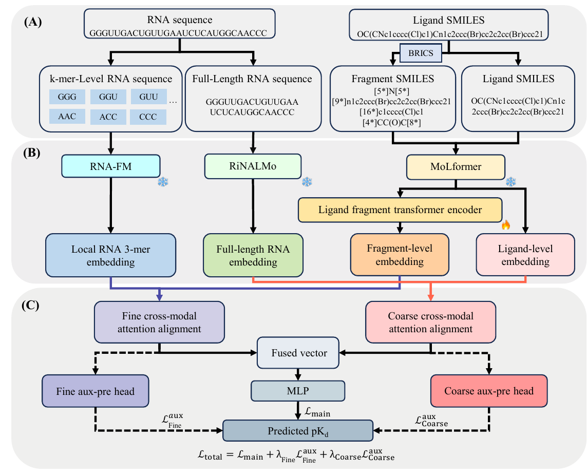

# MGCA-Net

**Multi-Granularity Cross-Modal Alignment Network for RNA–Ligand Binding Affinity Prediction**

Hongyu Yang, Zhaoxiang Liu, You Wu, Lei Kou, Qingyan Tian, Lei Zhong, Munisa Yalkun, Xinyu Chen, Wen Wang, and Haitao Fu

MGCA-Net estimates binding affinity (pKd) for an RNA–small-molecule pair. One attention branch aligns the whole ligand with the full RNA sequence. A second branch aligns BRICS fragments with overlapping RNA 3-mers. The model combines the two representations to predict affinity.

## Model architecture

[](figures/model.pdf)

The figure shows the manuscript architecture. Its full-length RNA branch is labeled RiNALMo. In the five released checkpoints, both RNA branches use 640-dimensional RNA-FM features. RNA-FM layer 12 reproduced the archived full-length and 3-mer tensors exactly for all 289 RNAs. The ligand branches use 768-dimensional MoLFormer features.

## Quick start

The standard evaluation requires the three R-SIM tables, cached features, original fold assignments and five trained checkpoints. This source release includes the code and architecture figure. Place the experiment files as described in the data and checkpoint directories before running these commands with Python 3.10 or later.

```bash
git clone https://github.com/hongyuyang224-sudo/MGCA-Net.git
cd MGCA-Net
python -m pip install -r requirements.txt
python create_data.py
python evaluate.py
```

`create_data.py` assembles the interaction dataset from the included features. `evaluate.py` scores each test pair with its held-out fold model and writes the per-fold metrics to `results/held_out_folds.csv`. These commands use the local feature cache and require no encoder downloads.

## Standard five-fold results

The R-SIM evaluation contains 1,328 labeled pairs spanning 289 RNAs and 738 ligands. Each pair appears in exactly one test fold. The values below are means across the five test folds, reproduced with the archived checkpoints using CUDA mixed precision.

| RMSE ↓ | MAE ↓ | Pearson r ↑ | Spearman ρ ↑ |
| ---: | ---: | ---: | ---: |
| 0.9231 | 0.6487 | 0.7544 | 0.7468 |

## Train and predict

After running `create_data.py`, choose the command for your task.

| Task | Command | Output |
| --- | --- | --- |
| Train five models using validation RMSE for early stopping | `python training.py` | Fold checkpoints under `checkpoints/`, histories in `logs/`, metrics in `result/` |
| Average predictions from the five released checkpoints for every labeled pair | `python predict.py` | Prediction tables in `results/final_data_random/ensemble_all_data/` |

The ensemble includes models trained on some of the scored pairs. Use `evaluate.py` for held-out metrics.

## Repository contents

- [Data](data/README.md) — interaction tables in `data/raw/`, per-entity tensors in `data/features/`, and original train, validation and test indices in `data/folds.json`.
- [Checkpoints](checkpoints/README.md) — the five sets of weights used for the results above.
- [Model implementation](models/model.py) — fragment encoder, cross-modal attention branches, auxiliary heads and fusion network.
- [Feature extraction scripts](preprocess/) — RNA and ligand encoders for experiments with newly extracted features.

## Optional feature extraction

The reproduction commands above use the cached features and run without downloading pretrained encoders. For separate extraction experiments, run the following from the repository root.

- For RNA-FM, install the upstream `fm` package, place its `RNA-FM_pretrained.pth` file in `models/`, and run `python preprocess/extract_rna_fm_embedding.py`. [RNA-FM](https://github.com/ml4bio/RNA-FM)
- For ligand features, install RDKit and `transformers==4.41.2`, run `python preprocess/brics.py`, then `python preprocess/extract_molformer_embedding.py`. The script loads the Hugging Face model and its custom modeling code. A fresh extraction completed for all 738 ligands using Transformers 4.41.2. The resulting vectors differed from the historical tensors, including after matching fragments by SMILES. The exact conditions needed to regenerate the historical ligand vectors remain unverified. Use the historical feature cache for the checkpoint evaluation. [MoLFormer weights](https://huggingface.co/ibm/MoLFormer-XL-both-10pct)
- For the alternative full-length encoder, install RiNALMo with its upstream dependencies and run `python preprocess/extract_rinalmo_embedding.py`. [RiNALMo](https://github.com/lbcb-sci/RiNALMo)

Extraction outputs go to `data/processed/extracted/`. The standard evaluation always reads the archived features through `create_data.py`.

## Data source

Krishnan, S. R., Roy, A., and Gromiha, M. M. (2023). *R-SIM: a database of binding affinities for RNA-small molecule interactions*. Journal of Molecular Biology, 435, 167914. [Publisher record](https://doi.org/10.1016/j.jmb.2022.167914)
